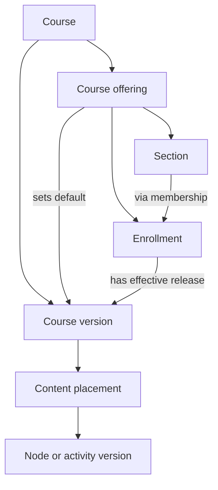
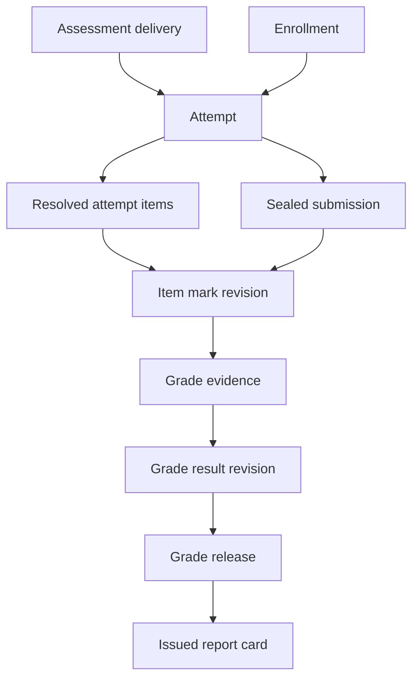

# Domain model

This chapter is a conceptual orientation. Use the [detailed ownership contract](../specification/architecture/02-ownership-and-dependencies.md), [domain catalogs](../specification/README.md) and [generated entity dictionary](../reference/README.md) for authoritative record names, fields, states and interfaces. The tables below group some record families for explanation; they are not migration or table definitions.

The logical names and constraints are independent of tables, classes, APIs and storage engines. The [curriculum](learning.md), [assessment](assessment.md) and [interoperability](interoperability.md) chapters specify their local aggregates and rules. Add extension data through versioned typed records or schemas. Core relationships must remain queryable and enforceable.

## Keys, versions and provenance

- Durable identities carry opaque UUIDs. Choose and document an [RFC 9562](https://www.rfc-editor.org/rfc/rfc9562.html) UUID profile. Local numeric storage keys are allowed as long as the UUID is unique, retained and accepted at external boundaries. Identifiers convey identity only. Institution and object permissions are checked independently.
- A mutable business identity such as a course has a durable UUID. A published version has its own UUID and an owner-local sequence. Its content and material references are immutable. Drafts carry a revision token for concurrent edits. Distinct releases and corrections record parent revision, reason, actor, time and provenance.
- Use scoped unique keys for human codes and external identifiers. External object mappings include the institution, authenticated source connection or namespace, source scope, object kind, external key and typed target. The owning catalog defines the full unique tuple. Treat source identifiers as opaque text and allow multiple aliases to point to a target. Retain original identity on retry. Copying curriculum as an independent fork creates new logical identities and records lineage.
- `ContentPlacement` identifies where reusable content appears in a specific course version. Its stable placement key correlates equivalent positions across versions of the same course. Two placements of the same activity are distinct teaching and progress contexts. A copied placement receives a new placement key. The parent of a placement must belong to the same version.
- Scored activity state carries the effective course release, delivery and policy, concrete item versions and generated values. Resumption, review, grade calculation and regrade must resolve those versions without consulting mutable authoring state.
- Use UTC instants for persistence, together with the policy time zone and local intent where calendars depend on them. Use exact decimal or rational scoring arithmetic with explicit precision and rounding. Store elapsed durations separately from deadlines.
- Each institution-scoped record includes or has an enforceable path to its institution. Use same-institution constraints for referenced rows or authorize and validate them in the owner transaction where the store cannot express the relationship. Cross-institution publication or sharing creates a policy-governed copy or a specifically scoped read grant.
- Store file bytes by immutable version with digest and type metadata. Authorization follows the permitted asset reference, even when two references point to the same digest. Retain learner records and reference versions according to institutional retention and access rules.

## Relationships

`1:N` gives maximum cardinality. Optionality and uniqueness are specified in the tables.

| From | To | Relationship and rule |
| --- | --- | --- |
| Institution | OrganizationUnit, AcademicPeriod, Person | 1:N each. Organization units form an acyclic tree. Academic periods may nest without requiring all calendars to have the same shape |
| Person | Principal, Enrollment | 1:N each. A principal can instead identify a service. Institutional links to a person remain separately governed |
| Principal | RoleAssignment | 1:N. Each role assignment has one scope and effective interval |
| Program | Course | N:M through versioned program requirements and equivalents |
| Course | CourseVersion, CourseOffering | 1:N each. A course version can be used by multiple offerings |
| CourseOffering | CourseVersion | N:1 to the default release for new enrollments. Each enrollment resolves its effective release through an explicit assignment history |
| CourseVersion | ContentPlacement | 1:N. Placements form a tree with sibling order. Availability and prerequisites are separate directed edges |
| ContentPlacement | ContentNodeVersion or ActivityVersion | N:1 to exactly one typed payload |
| ContentNode | ContentNodeVersion | 1:N. The same rule applies to Activity, Asset and Item |
| Library | LibraryEntry | 1:N. A library entry points to a reusable identity, and each published reference resolves to one exact version |
| CourseOffering | Section, LearningGroup, Enrollment, AssessmentDelivery | 1:N each |
| Enrollment | Section, LearningGroup | N:M through temporal memberships, subject to institution and offering consistency |
| Cohort | Person | N:M through temporal cohort memberships. A cohort rule can propose enrollments |
| Enrollment | LearningProgress, Attempt, GradeResultRevision | 1:N each. Stored history is not transferred implicitly when a person moves offerings |
| AssessmentDelivery | AssessmentVersion, ContentPlacement | N:1 each. An assessment delivery records effective policy and context |
| AssessmentVersion | ItemVersion | N:M via fixed slots or pinned candidate pools. A pool definition and the concrete draw are distinct |
| Attempt | AttemptItem, AttemptSubmission | 1:N items and at most one submission. Item marks and responses retain revision history |
| GradeItem | GradeResultRevision | 1:N across enrollments and revisions. Each enrollment and grading scope has at most one current result pointer. Category and offering rollups have their own scope |
| ReportCard | ReportCardRevision | 1:N. Each issued version refers to the released records and policy from which it was calculated |
| PackageVersion | PackageRegistration and resource manifest | 1:N. An attempt pins the package version and target learner placement |

## Entity dictionary

Fields shown below are the minimum business keys and references. Add immutable creation provenance, state transition evidence, and optimistic revision tokens where applicable. Fields with suffix `_id` refer to domain IDs. Local status enums and access conditions are defined in the relevant workflow chapter.

### Institution and teaching

| Entity | Key fields | Invariants and high-use access paths |
| --- | --- | --- |
| Institution | ID, code, name, timezone, locale, policy version, state | Unique installation code. Bound every tenant query and background job |
| OrganizationUnit | ID, institution ID, parent ID, code, kind, state | Unique code within configured parent scope. Prevent cycles |
| Person | ID, institution ID, record status, permitted profile attributes | Institution-scoped education record. Do not key a learner on email or display name |
| Principal | ID, kind, optional person ID, authority reference, state | A person may have multiple authorized login principals. Service principals have no learner relationship |
| ExternalIdentity | ID, identity connection ID, provider subject, principal ID, active interval | Unique provider subject within a connection. No automatic identity merge on email |
| RoleAssignment | ID, principal ID, role code, scope type and ID, valid from and to, grant provenance | Validate target and action scope. Preserve previous grants for audit |
| AcademicPeriod | ID, institution ID, optional parent ID, code, dates, closed state | Applicable time zone is explicit. Closure changes write permissions and allows authorized amendment |
| Program and requirements | Program ID, unit ID, code, requirement revision, course or course group, credits, equivalency rule | Freeze the applicable program rules per learner pathway when needed |
| CourseOffering | ID, course ID, pinned course version ID, period ID, code, pacing mode, access interval, timezone, state | Stable across roster edits. A new default affects future enrollments. Roll out to existing enrollments explicitly |
| EnrollmentRelease | ID, enrollment ID, course version ID, effective interval, decision, rollout reference | One active release per enrollment. Record mapping and equivalence decisions for carried progress. Historical attempts retain their original context |
| Section | ID, offering ID, code, timetable, optional capacity, state | Unique offering-local code. Staff scopes reference the section ID |
| LearningGroup | ID, offering ID, purpose, label, optional activity scope | Group type governs visibility, capacity and possible simultaneous membership |
| Cohort | ID, institution ID, code, origin, state | Cohort membership and course participation have independent lifecycles |
| Enrollment | ID, offering ID, person ID, registration source, effective status, access interval, applicable policy | Unique person and offering. Reinstatement uses the same record with a history event |
| SectionMembership, GroupMembership and CohortMembership | Enrollment or person ID, target ID, effective dates, reason, source | No overlapping duplicate assignment. Enforce any exclusive class or group policy across concurrent updates |
| Accommodation | ID, enrollment ID, assessment or offering scope, effective dates, restricted evidence reference, effective adjustment | Return the effective adjustment to delivery. Limit the underlying evidence to authorized staff |

### Curriculum and progress

| Entity | Key fields | Invariants and high-use access paths |
| --- | --- | --- |
| Course | ID, institution and owner unit IDs, catalog code, catalog metadata, archived flag | Code can change while ID remains. Public catalog projections expose approved metadata only |
| CourseVersion | ID, course ID, version number, locale strategy, publication state, manifest hash | Enforce course and version number uniqueness. Resolve all published placement and policy refs |
| ContentNode and ContentNodeVersion | Logical ID, type, owner, version ID, content payload and schema version, locale and accessibility metadata | Distinguish authored lesson or resource from its contextual placement |
| Activity and ActivityVersion | Logical ID, owner, kind, version ID, validated configuration, renderer contract, completion behavior | Separate protected grading configuration from learner-visible activity payload |
| ContentPlacement | ID, stable placement key, course version ID, parent ID, order, payload type and version ID, applicable rules | Unique stable placement key per course version and ordered children per parent. Prevent outline cycles and dangling refs |
| Library, LibraryEntry | Library ID, owner and visibility, entry ID, target identity, tags and collection membership, current release pointer | Course releases pin resolved versions. Recording an upstream update does not mutate dependent versions |
| Asset and AssetVersion | Logical ID, asset version ID, type, size, digest, storage reference, access and rights metadata, alternatives | File references identify exact versions. Delete bytes only after checking active dependencies and retention |
| Outcome and alignment | Outcome ID, framework revision, source code, alignment target kind and version, relevance | Many-to-many links for course, placement, item and program. Competency decisions use explicit evidence |
| Availability and completion rules | Rule ID, placement or offering context, policy version, expression, applicable window and audience | Validate dependencies and circular prerequisites. Store class and learner exceptions separately |
| LearningProgress | Enrollment ID, placement ID, course version ID, state, first and last event, completion evidence, revision | Unique enrollment and placement projection in the versioned context. Keep progress evidence separate from display percentage |
| CompletionRecord | ID, enrollment ID, subject and version, rule revision, evidence refs, effective and recorded times | Recomputing progress cannot silently remove an issued completion or credential |

### Assessment, records and interoperability

| Entity family | Key fields | Invariants and high-use access paths |
| --- | --- | --- |
| Item and ItemVersion | Logical ID, version ID, bank, prompt, response schema, protected marking rules, feedback and asset refs | Bank access scopes authoring. Learner delivery receives a redacted projection |
| AssessmentVersion and AssessmentDelivery | Version ID, blueprint and slots. Delivery ID, offering, placement, version, policy, release, windows | Distinguish the test definition from where and when it is administered |
| Attempt and AttemptItem | Attempt ID, enrollment, delivery, sequence, policy revision, deadline, state. Attempt item ID, exact item version, draw and parameter snapshot | Unique attempt sequence per enrollment and delivery. Concurrency controls enforce attempt limits and submission cutoff |
| AttemptSubmission and ItemMarkRevision | Submission ID, attempt and response snapshot, finalization evidence. Mark revision ID, target, points, rubric or engine version, provenance | One authoritative submission per attempt. Marking, moderation and regrading append decisions and update approved pointers |
| GradeItem and GradeResultRevision | Item ID, offering, source, category and policy version. Result ID, enrollment, grade item, selected mark evidence, grade state, override lineage | Grade rollups are recalculable from pinned rules. Posted state is independently authorized and recorded |
| ReportCard and ReportCardRevision | Record ID, learner, period and report type. Revision ID, issue state and number, results and policy snapshot, approval and amendment links | Learner history remains stable when course text or grade scales change. Amendments supersede with reason |
| PackageVersion and PackageRegistration | Version ID, validated archive, profile, launch manifest and digest. Attempt ID, enrollment, placement and exact version, runtime profile and state | Runtime data is isolated by attempt and launchable unit. Validate and normalize outcomes before records intake |
| TransferJob and ExternalObjectMap | Job ID, namespace, archive digest, adapter profile, state, report and author approval. Map ID, source object tuple and target | Retry and replay preserve identities. Re-import reports conflicts and avoids automatic destructive removal |
| AuditEvent, OutboxEvent and InboxReceipt | Event ID, occurrence, source, actor or principal, purpose, entity refs, minimal payload, contract version and correlation ID | Use append-only evidence, deduplicated intake, restricted audit and independently rebuildable projections |

## Lifecycle and consistency

| Record | Minimum states or events | Write rule |
| --- | --- | --- |
| Course version | Draft, in review, published, superseded, archived | Only a published version can drive ordinary delivery. Archived versions remain resolvable for authorized history |
| Offering | Draft, scheduled, open, closed, archived | Availability and grades have independent windows. Archive preserves published records |
| Enrollment | Active, suspended, withdrawn or closed | Keep applications and waitlists separate from participation. Record status changes. Completion and access remain independent |
| Assessment attempt | In progress, submitted or expired, marking, finalized or voided | Concurrent saves and finalization have defined precedence. A void preserves evidence and reason |
| Grade result | Ungraded or pending, proposed, confirmed, posted, amended | The assessment owner supplies evidence. The records owner authorizes posting and amendment |
| Report card | Draft, approved, issued, superseded or revoked | An issue is a snapshot, and its correction creates a new revision |

Public commands carry actor or service principal, institution, target, revision token when required, and an idempotency key where a repeat can change state. Bind the key to the request and reject changed payloads that reuse it. Authorize before returning an existing result. Each command validates expected state and scope, writes its facts and durable event in the same transaction, and reports conflict or rejection explicitly. Model lifecycle events separately where a projected state collapses multiple causes. A grade can be posted independently of whether an attempt allows review.

For query performance, index offering rosters by status and section, course trees by version and parent order, due work by learner and effective deadline, grading queues by assignee and state, and results by offering, period, learner and release state. Add indexes from measured query plans. Keep list and report queries bounded by tenant, scope, keyset cursor and authorized fields. Rebuild read projections from owner facts and keep release and permission decisions anchored to authoritative state.

## Reference paths

The curriculum-to-learner path separates what was authored from what is offered and who is enrolled.

The evidence path preserves the source for every published academic result.

