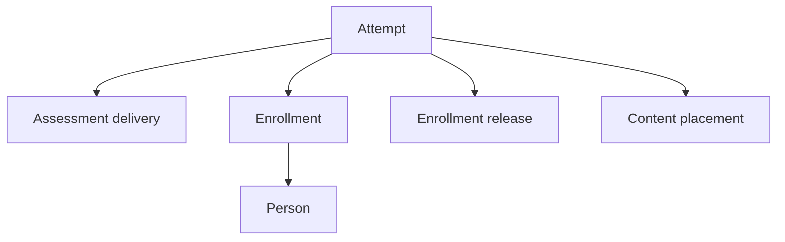

# 08. GUID relationships, selectors and generated ACL

Build the table, fields, form, list and normal edit routes from JCB. Compose backend workspaces and selectors from those attached records and the current JCB reference features. Add an owner check or a narrowly scoped hook where an LMS relationship has an institution, assignment, release or immutable-record rule that the generated path cannot decide by itself.

## 8.1 What the current references establish

| Evidence | Verified mechanism | Boundary |
| --- | --- | --- |
| Current JoomEngine Skills at `e7b8723` | Reuse the complete Field, Field Type, owning Admin View, Custom Code and Power graph. Application GUID relationships retain local numeric Joomla table IDs | Resolve the actual Joomla, PHP and JCB versions when building. The reference hashes make observations reproducible |
| Service Directory blueprint at `a0041f0` | 24 attached Admin Views with 18 main menu flags. The compiled manifest contains 20 submenu entries including its dashboard and custom entry. The generated component combines ordinary forms, managed selectors, hidden child records, a custom menu and composed queries | This is evidence that a cohesive component can have many attached definitions while navigation exposes a smaller set |
| Production Playground manifest at `c49d025` | The named Service Directory deployment selects Joomla 6 package revision `b2cf7f8` and keeps JCB installation optional. The downloaded package checksum matches the deployment manifest. The verified package contains the generated City/State modal, Companies query fields and normalized Company Addresses form and model | Package inspection and published test source establish the reference mechanism. The manifest and tests exercise installation, page health and a same-component GUID join. They do not establish an installed two-component LMS workflow |
| JCB compiler `6.x@037752c` | Custom fields accept explicit component, table, view and option key configuration. Modal fields support GUID title lookup, list selection and generated return metadata. Admin View and field actions produce Joomla ACL definitions | Verify both independently compiled components for cross-component selectors, the target return value, current user scope and generated task behavior |

[Skills reference features](https://github.com/joomengine/skills/blob/e7b8723397811772c85358e72ce91ab594785748/examples/reference-patterns.md) · [Service Directory blueprint attachments](https://github.com/joomengine/joomla-packages/blob/a0041f0d408ca65ac43796f89a90c88063fe85a8/src/joomla_component/children/160d0efb-6bf0-48eb-8d46-55cf74729501/component-admin-views.json) · [Production deployment manifest](https://playground.joomengine.org/assets/manifest.json) · [Playground deployment recipe](https://github.com/joomengine/playground/blob/c49d02588d1a5276ab78d3dc3f5e3df19d30e463/deploys/servicedirectory.json) · [Compiled Service Directory menu](https://github.com/joomengine/Joomla-Service-Directory/blob/d25ca95084d79e552e2ae99f67011679d41d3ad4/servicedirectory.xml#L66-L90) · [Playground GUID join test](https://github.com/joomengine/playground/blob/c49d02588d1a5276ab78d3dc3f5e3df19d30e463/test/custom-extension-url.browser.mjs#L261-L267)

## 8.2 Bind Joomla accounts to educational identities

| Identity | Physical or logical representation | Use |
| --- | --- | --- |
| Joomla host account | Integer `#__users.id` from the authenticated Joomla identity | Host session, account, group and ACL decisions. A privileged account-binding form can select the integer through Joomla's `type="user"` control |
| Provider subject | Exact integer serialized as the subject string under the installation's configured identity connection and issuer | Resolve verified `ExternalIdentity`. Institution, connection, issuer and subject fingerprint scope uniqueness |
| LMS principal and person | `ExternalIdentity.principal_id → Principal.guid` and `Principal.person_id → Person.guid` | Principal receives effective scope grants. Person is the educational identity used by enrollment and records |
| JCB definition and table identities | Definition GUID for the view/field blueprint, numeric `id` for the Joomla row, immutable `guid` for the application record | Resolve blueprint dependencies by definition GUID. Resolve education links by row GUID. Use numeric ID in generated local edit routes and Joomla assets |

Use the Joomla User field in the privileged binding form and use JCB field permissions and view actions for access to that form. A local adapter can expose a transient `host_user_id` control with `admin_fields.addfields.list=2`. It is a form parameter, with no LMS relationship column. The existing `BeginExternalIdentityLink` and `LinkExternalIdentity` workflows verify the authenticated subject or approved staff decision, resolve the institution-scoped identity connection, and record the protected subject reference and fingerprint. Selecting a host account alone never grants enrollment, course authorship or access to scores.

For example, Joomla account `41` on the first site maps to an ExternalIdentity and a Principal for learner P. The same person's account on a second site can have integer `206` under a different identity connection. Both authorized links resolve the intended Person GUID. An Enrollment always refers to P's GUID. Import or account relinking uses the explicit scoped identity mapping. Matching a name, email, row number or display alias cannot merge the academic record. Blocking a Joomla account denies current host actions while the learner's authorized history remains attached to the Person.

[Host identity and academic access](03-host-identity-and-academic-access.md) · [Platform identity contract](../platform/03-authentication-and-account-binding.md) · [Joomla User field](https://manual.joomla.org/docs/next/general-concepts/forms-fields/standard-fields/user/) · [Service Directory generated User and repeatable Fields](https://github.com/joomengine/Joomla-Service-Directory/blob/d25ca95084d79e552e2ae99f67011679d41d3ad4/admin/forms/company.xml#L159-L188)

## 8.3 Configure a typed relationship once

The proposed physical names below follow the component allocation. Verify the final installed names and select the matching compiled owner route. Every application target has a unique immutable `guid`. Its consumer's relation column keeps the corresponding string and gets an appropriate index. In portable catalogs the relation is called `person_id` or `offering_id`. The value stored in it is the target row's GUID.

| Consumer field | Target owner and physical key | Appropriate control or source |
| --- | --- | --- |
| Enrollment `person_id` | `com_lmsinstitution`, `#__lmsinstitution_person.guid` | Scoped Person selector in registrar flow. Display `display_name` only to the authorized institution roster scope |
| Enrollment `offering_id` | `com_lmsdelivery`, `#__lmsdelivery_course_offering.guid` | Offering selector or authorized fixed offering from the enrollment command |
| AssessmentDelivery `offering_id` | `com_lmsdelivery`, same CourseOffering target | Scoped cross-component selection from an assessment setup form |
| Attempt `enrollment_id`, `enrollment_release_id`, `delivery_id` and `content_placement_id` | Exact owning rows through typed GUIDs | Context resolved by `StartAssessmentAttempt`. Staff views may read the approved context. Editable form controls cannot reassign a started attempt |

In JCB Field storage, the ordinary scalar pattern uses `store=0`. The Field configuration offers `indexes=1` for unique and `indexes=2` for ordinary indexes. Set explicit unique indexes on row GUIDs, ordinary relationship indexes on the referencing fields, and the owner-specific composite uniqueness required by the catalog. For a 36-character custom length the observed XML-independent Field storage keys are `datalenght=Other` and `datalenght_other=36`. Keep canonical representation and compatible collations across both sides. Compare installed SQL. The Service Directory specimen includes ordinary GUID indexes, so it demonstrates linkage without establishing uniqueness for the LMS.

[Application identity workflow](https://github.com/joomengine/skills/blob/e7b8723397811772c85358e72ce91ab594785748/packages/workflows/application-identities.md) · [Field storage and indexes](https://github.com/joomengine/skills/blob/e7b8723397811772c85358e72ce91ab594785748/packages/models/fields-and-relationships.md) · [Reference installed key shapes](https://github.com/joomengine/Joomla-Service-Directory/blob/d25ca95084d79e552e2ae99f67011679d41d3ad4/admin/sql/install.mysql.utf8.sql#L455-L527)

### Managed ModalSelect

Use the shared ModalSelect Field Type and its connected target view for standard selection. The example shows the assessment setup Field selecting an existing CourseOffering across components. The owner supplies the authorized modal list. Its selectable value and display label use separate columns.

```xml
<field
    type="ModalSelect"
    name="offering_id"
    label="Course offering"
    sql_title_table="#__lmsdelivery_course_offering"
    sql_title_column="title"
    sql_title_key="guid"
    urlSelect="index.php?option=com_lmsdelivery&amp;view=course_offerings&amp;layout=modal&amp;tmpl=component&amp;titleKey=guid"
    titleSelect="Select a course offering"
    select="true"
    new="false"
    edit="false"
    clear="false"
    required="true"
/>
```

The Service Directory City form uses this mechanism for `state`, with `sql_title_key="guid"` and a target State modal. JCB adds `data-key-name="guid"` and a GUID-aware title lookup in the consuming field override. The target list uses `titleKey=guid` to return the selected value as `data-id`. The same list retains numeric IDs for ordinary edit links. Choose the target's actual generated plural code and confirm the returned key and display title.

The string title override reads its configured table and title by key. Its lookup does not perform institutional authorization. Bind only already-authorized stored or recovered values, restrict the selectable list under the owning scope, and revalidate on save. Where the field can reveal a private title through a disallowed supplied or recovered key, use a scoped custom selector whose lookup is guarded. Never rely on a hidden control, disabled action or a title lookup as a scope check.

[ModalSelect workflow](https://github.com/joomengine/skills/blob/e7b8723397811772c85358e72ce91ab594785748/packages/workflows/modal-relationships.md) · [Compiler ModalSelect extraction](https://github.com/joomengine/Joomla-Component-Builder/blob/037752c7e6599aa4cec900138dfb61af7ee4ba8f/libraries/vendor_jcb/VDM.Joomla/src/Componentbuilder/Compiler/Field/ModalSelect.php#L72-L155) · [Compiled City form](https://github.com/joomengine/Joomla-Service-Directory/blob/d25ca95084d79e552e2ae99f67011679d41d3ad4/admin/forms/city.xml#L116-L139) · [Title lookup](https://github.com/joomengine/Joomla-Service-Directory/blob/d25ca95084d79e552e2ae99f67011679d41d3ad4/admin/src/Field/ModalSelectField.php#L30-L62) · [State modal callback](https://github.com/joomengine/Joomla-Service-Directory/blob/d25ca95084d79e552e2ae99f67011679d41d3ad4/admin/tmpl/states/default_body.php#L70-L93)

Where the same work requires target New or Edit, import the target's shared `formControllerEdit` Custom Code in its `php_controller` and the connected Power. Configure `urlNew` with the owner singular `.add` task. Configure `urlEdit` with the owner singular `.edit` task, `guid={id}` and the modal parameters. In this template substitution `{id}` means the selected value, which is the GUID. The companion edit code resolves it to the local numeric ID and delegates to the generated controller for checkout and ACL. Verify linked-New defaults against the actual child field keys and failed-form recovery before adding an adapter.

Select and saved return use different mechanisms. The compiler records title metadata in the current build and initializes target Edit View metadata to `id` and `name`. The target's generated modal return uses compiled metadata, while the list gets the key from its request. A foreign consumer field alone cannot configure the separate target build. For independently compiled components, enable modal New/Edit only once the target owner's supported configuration is generated and the saved callback demonstrably returns the GUID and intended title. Otherwise retain select-only and send users to the normal owner workflow for changes.

[Target State blueprint](https://github.com/joomengine/joomla-packages/blob/a0041f0d408ca65ac43796f89a90c88063fe85a8/src/admin_view/8345b808-fc30-4b51-8c9b-05e96bfe26d6/item.json) · [Reusable edit adapter](https://github.com/joomengine/packages/blob/4fd6ce1f2a11a478abb291d03a1a3b32ceeda5c9/src/custom_code/formControllerEdit/item.json) · [Target compile defaults](https://github.com/joomengine/Joomla-Component-Builder/blob/037752c7e6599aa4cec900138dfb61af7ee4ba8f/libraries/vendor_jcb/VDM.Joomla/src/Componentbuilder/Compiler/Architecture/AdminViews/EditView.php#L454-L468) · [Modal return template](https://github.com/joomengine/Joomla-Component-Builder/blob/037752c7e6599aa4cec900138dfb61af7ee4ba8f/admin/compiler/joomla_6/ADMIN_VIEW_MODAL_RETURN.php#L24-L36)

### Query-backed selector for a restricted roster

Use a core Joomla SQL Field for a bounded option list whose rows can safely be returned from its fixed query. Its relevant option mapping attributes are `key_field` and `value_field`. For a Person picker, reuse the generated JCB Custom Field pattern extending `list`, adapt its query body to the authorized owner projection, and bind scope from trusted server context. An offering selected in a browser request can narrow the available roster only after the server authorizes that offering.

| Saved Field configuration | Service Directory example | LMS Enrollment Person selector |
| --- | --- | --- |
| Concrete `type` and `name` | `countries`, `country` | Distinct generated `enrollmentpeople` type, `person_id` relation |
| `extends` and `button` | `list`, `false` | `list`, `false` for selection without generic account creation |
| `table` and `component` | `#__###component###_country`, `com_###component###` | `#__lmsinstitution_person`, `com_lmsinstitution` |
| `view` and `views` | `country`, `countries` | `person`, `people` |
| `key_field` and `value_field` | `guid`, `name` | `guid`, `display_name` |
| `prime_php` and `type_php_1` | Saved code builds the query and returns GUID-valued options | Reuse the same Field Type and code pattern, replacing the public published filter with authorized roster scope and minimal projection. Test existing authorized selection, invalid key and out-of-scope key |

The compiler reads those attributes and resolves the custom field code's `###TABLE###`, `###ID###` and `###TEXT###` placeholders. The concrete Field's PHP serialization and Field Type catalogue are distinct. Acquire the actual connected Field Type and inspect generated class and option values. Keep the target component explicit for a foreign owner. Do not replace it with the consuming component's placeholder. Use scope-aware existing query or owner Power only for the academic restriction that a static list cannot express.

[Joomla SQL Field](https://manual.joomla.org/docs/next/general-concepts/forms-fields/standard-fields/sql/) · [Country Custom Field blueprint](https://github.com/joomengine/joomla-packages/blob/a0041f0d408ca65ac43796f89a90c88063fe85a8/src/field/1c8bc5a9-06ab-429f-99d7-0b48e6b2b118/item.json) · [Generated Countries Field](https://github.com/joomengine/Joomla-Service-Directory/blob/d25ca95084d79e552e2ae99f67011679d41d3ad4/admin/src/Field/CountriesField.php#L44-L66) · [Compiler Custom Field attributes](https://github.com/joomengine/Joomla-Component-Builder/blob/037752c7e6599aa4cec900138dfb61af7ee4ba8f/libraries/vendor_jcb/VDM.Joomla/src/Componentbuilder/Compiler/Field/Attributes.php#L894-L1005) · [Compiler Custom Field placeholders](https://github.com/joomengine/Joomla-Component-Builder/blob/037752c7e6599aa4cec900138dfb61af7ee4ba8f/libraries/vendor_jcb/VDM.Joomla/src/Componentbuilder/Compiler/Creator/CustomFieldTypeFile.php#L510-L597)

## 8.4 Build the roster and attempt workspaces

A **Custom Admin View** can show a scoped roster, attempt review or cross-record status workspace. Attach it with `component_custom_admin_views.addcustom_admin_views`. Set `main_get` for the primary Dynamic Get and `custom_get` for additional view datasets. Compose the view from templates and layouts. For an LMS read-only workspace, omit write routes and give task buttons the corresponding existing owner actions. A Custom Admin View can be configured with custom actions, so read-only is a deliberate surface choice.

The allocation gives Delivery separate generated workspace routes for admissions and roster reconciliation, Institution a workspace for access review, and Assessment Delivery an exam-control workspace. Use each workspace attachment and the generated submenu or dashboard flags for its own navigation. Keep supporting table views attached without exposing unnecessary menu entries. The target permission is checked even when a direct URL bypasses the menu.

An **Admin View** owns the normal table, item form, list model and generated modal route. Attach its Fields and place the view in `component_admin_views.addadmin_views`. Use the Admin View when a selector must open an actual managed target. Keep an attached internal child off the ordinary menu without changing its schema ownership.

Register the owner implementations through the supported component and shared Power service providers. Resolve the declared `lms.institution_context`, `lms.enrollment_delivery` and `lms.assessment_attempts` contracts through the package service boundary and verify their installed readiness before use. The configured table name selects a data source. Its presence cannot substitute for the owner contract, authorization or a supported schema revision. A custom Field needing a database query can use the existing Joomla container and `DatabaseInterface` pattern. The target owner still supplies the authorized query or Power where needed. Use the owning component’s Data factory and short table name for its ordinary local subforms. A foreign field does not grant authority to mutate the other component’s table. [Component lifecycle and readiness](09-component-dependencies-and-lifecycle.md)

For a roster query inside `com_lmsdelivery`, load Enrollment through its Admin View and join `a.person_id = p.guid` to the Person table. In a Dynamic Get, use `join_view_table` and the appropriate definition GUID for same-component generated tables. For an explicit different component's table use `join_db_table`, with `db_table=lmsinstitution_person` as the unprefixed name. The inspected compiler adds `#__` for a database-table source and builds the compiling component's prefix for an Admin View source. A single-row join can use `row_type=1`, alias `p`, `on_field=a.person_id`, `operator=1` and `join_field=p.guid`. Select only the authorized projected fields and use the appropriate join type and scope predicates. Use `row_type=2` for a real related collection when the consuming getter and its filters match that result shape.

The attempt workspace resolves its subject through exact immutable links.



For an individual attempt, `StartAssessmentAttempt` resolves the learner's Enrollment, exact EnrollmentRelease, AssessmentDelivery, policy and ContentPlacement. Validate that the release belongs to that enrollment, the delivery is for the same offering, and the placement belongs to the release's exact version. Store the captured version GUIDs and use them when rendering historical work. A teacher's roster link or a later offering release does not change any pinned attempt relationship. A team uses its separately validated TeamSnapshot and member release pins.

For example, two institutions can have an offering displayed as Garden Measurements, while their GUIDs and Person names differ. A teacher who can open the assessment component sees only authorized offerings and attempt rows. A manually submitted GUID from the other institution fails before any record or title is changed. The existing host ACL gate, shared selector, typed joins and owner checks each retain their normal responsibilities.

[Dynamic Get workflow](https://github.com/joomengine/skills/blob/e7b8723397811772c85358e72ce91ab594785748/packages/workflows/dynamic-get.md) · [Dynamic Get source mapping](https://github.com/joomengine/Joomla-Component-Builder/blob/037752c7e6599aa4cec900138dfb61af7ee4ba8f/libraries/vendor_jcb/VDM.Joomla/src/Componentbuilder/Compiler/Dynamicget/Selection.php#L106-L127) · [Service Directory Company query](https://github.com/joomengine/joomla-packages/blob/a0041f0d408ca65ac43796f89a90c88063fe85a8/src/dynamic_get/3071eabb-8a2d-4281-b6a4-179dbfb30774/item.json) · [Demo Custom Admin View](https://github.com/joomengine/packages/blob/4fd6ce1f2a11a478abb291d03a1a3b32ceeda5c9/src/custom_admin_view/917d2c1a-1b37-4ded-9ace-ef486fcc3e4d/item.json)

## 8.5 Reuse generated ACL and normalized form handling

| JCB surface | Configure in the blueprint | Verify in generated and installed output |
| --- | --- | --- |
| Admin View permission actions | `admin_view.addpermissions` rows with `action` such as `view.access`, `view.create` or `view.edit`. `implementation=1` is record, `2` is whole view and `3` is both | Emitted `access.xml`, applicable Joomla assets and generated model/controller authorization |
| Attached Field actions | `admin_fields.addfields.permission` is a multiselect. `1` editing, `2` access, `3` view | Generated actions such as `city.edit.state`, `city.access.state` and `city.view.state`. Denied submitted fields can be unset. Verify raw form requests, selection results and protected field omission |
| Navigation | `mainmenu`, `submenu`, `dashboard_add` and `dashboard_list` on Admin View attachment. Custom Admin Views have their own attachment and supported menu/dashboard flags | Generated manifest, dashboard, submenu and direct route permissions. The compiler can gate the generated submenu with view access and submenu actions. A menu flag alone grants no operation |
| Generated edit/API exposure | Choose attachment `add_api` and frontend edit/create settings only for intended surfaces | Ordinary generated forms for mutable permitted data. Disable or guard bypass routes for sealed attempts, marking, publication and issued records |
| Normalized child editor | Attach the real child Admin View. Attach the parent repeatable Field as non-database `list=2`, expert `store=6`, with both `on_get_model_field` and `on_save_model_field` | Inspect generated `getItem`/form preload, save hook order, current `guid`, child key, parent link and actual SQL. Verify failed-save preservation and scope |

The reference Company Addresses editor uses the existing `Data.Subform` service. The get handler uses the parent `$item->guid`, the child table, parent relation key and selected child columns. The save handler uses submitted child rows, child `guid`, the same parent relation and normalized `$data['guid']`. JCB substitutes `[[[field]]]` for the matching expression in each handler. This pattern serves ordinary complete-collection edits. A present empty array requests clearing the editable collection, while the observed `isset` guard leaves an omitted or null input untouched. A malformed value or a foreign child GUID needs validation before invoking a replacement operation. Confirm both model handlers are generated, and inspect PATCH behavior on the pinned compiler and chosen host.

A teacher who can open the Delivery administration page still needs `participation.workspace.read` on the relevant offering, section or group to read its roster. Schedule changes require `participation.schedule.manage` on the applicable scope. An assigned marker needs `assessment.mark` on a permitted marking assignment, delivery or section. Exam control requires the separate `assessment.attempt.supervise` scope. Configure generated view and field permissions for the Joomla routes and controls, then let the existing owner scope check enforce the exact action and record. The teaching role alone supplies neither exam supervision nor answer-key access.

Reuse JCB's generated model, permissions, lifecycle and form handling for ordinary editable records. Add the minimum academic rule at the appropriate owner boundary. For a protected EnrollmentRelease history or sealed AttemptItem, a workspace can use generated reads and an explicit owner task. It cannot expose a generic replacement child collection for those immutable records. If an editable aggregate requires checked transaction behavior, verify the actual generated save/asset lifecycle and use the supported extension point for that specific invariant. The standard JCB form, Table and controller remain in place.

[Admin View authoring and permissions](https://github.com/joomengine/skills/blob/e7b8723397811772c85358e72ce91ab594785748/packages/models/admin-views.md) · [Compiler submenu permissions](https://github.com/joomengine/Joomla-Component-Builder/blob/037752c7e6599aa4cec900138dfb61af7ee4ba8f/libraries/vendor_jcb/VDM.Joomla/src/Componentbuilder/Compiler/Architecture/Menu/SubMenus.php#L204-L228) · [Company Addresses blueprint](https://github.com/joomengine/joomla-packages/blob/a0041f0d408ca65ac43796f89a90c88063fe85a8/src/field/36cb11a7-fe23-4d75-b579-12686db52fb8/item.json) · [Generated City field ACL](https://github.com/joomengine/Joomla-Service-Directory/blob/d25ca95084d79e552e2ae99f67011679d41d3ad4/admin/src/Model/CityModel.php#L348-L394) · [Generated Company load](https://github.com/joomengine/Joomla-Service-Directory/blob/d25ca95084d79e552e2ae99f67011679d41d3ad4/admin/src/Model/CompanyModel.php#L169-L205) · [Generated Company save](https://github.com/joomengine/Joomla-Service-Directory/blob/d25ca95084d79e552e2ae99f67011679d41d3ad4/admin/src/Model/CompanyModel.php#L1467-L1479)

## 8.6 Acceptance before claiming installed behavior

1. Import or acquire the complete Field, Field Type, owner Admin View, attachment, target permission and Custom Code graph. Save and reopen in JCB. Compile both the owning and consuming extensions against the declared target.
2. Inspect generated form XML, modal list and return, title lookup, permission conditions and indexed SQL. Confirm the target override resolves the chosen GUID and ordinary Joomla tasks use the actual local numeric ID.
3. Select an existing target in the consuming form, save and reopen, and verify the persisted foreign value is the GUID and the authorized label is correct. Exercise New/Edit only where enabled, including cancel, failed-save recovery and callback identity.
4. Test direct routes, malicious GUIDs, foreign institution and enrollment scopes, blocked host users and restricted field actions. Confirm an old cached selection, autocomplete or title lookup cannot disclose a protected label.
5. Repeat against a second installation with different numeric IDs. Compare stable typed GUID relations, including roster and historical attempt navigation. Run normalization or ACL denial cases through enabled form, API and import paths.
6. Test the child editor's authorized complete collection, omission, explicit clearing, invalid inputs, conflict and Copy behavior. Confirm a protected child cannot be altered through another owner route.

Record blueprint verification, generated package inspection and installed user-journey results separately. The Service Directory reference informs the design. The new cross-component selectors and LMS rules still need their own acceptance evidence.
