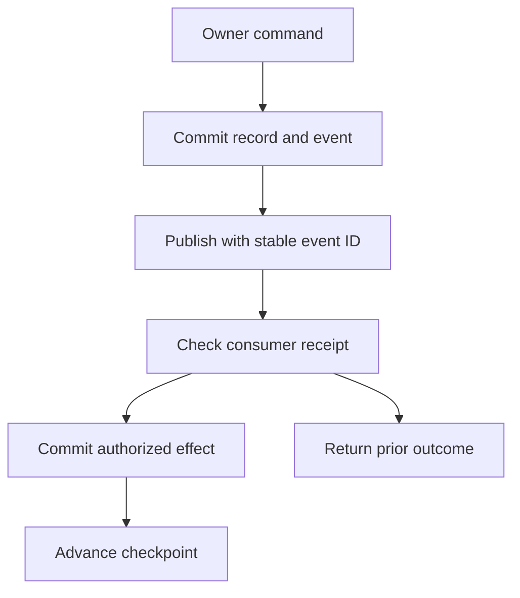

# 08 Durable commands, events and jobs

## Idempotent write algorithm

Use the request key as a transport replay handle and the owner operation's business key as the durable invariant. An accepted exam submission can remain unique after the HTTP receipt's default seven-day window. A transport retry never resets an attempt.

1. Authenticate and resolve current target and actor before accessing receipt state. Canonicalize the operation, target, validated body and version precondition with a stable serialization. Treat fields whose order matters as ordered. Strip transport metadata outside business semantics. Preserve intentionally distinct missing and explicit null values.
2. Lock the tuple `(institution, actor, operation, target, request_key)`. On a committed receipt with the same digest, recheck response visibility and return original committed status and representation reference. On a different digest return 409. Where the target is already opaque to the caller, return the same authorization failure as an ordinary request.
3. On a new request, evaluate owner invariants, actor, lifecycle and version under the appropriate locks. Use stable lock order for related objects. Apply one mutation, its effect, audit or outbox and replay receipt atomically.
4. If transaction fails before commit, the request can retry. If client loses response after commit, original outcome remains. Do not store arbitrary transient network failures as successful receipts. Report 503 on an unavailable commit and ask for exact retry rather than assuming success.
5. If an external side effect cannot join the transaction, persist intent and a stable effect key first, send or reconcile under worker scope, and confirm or mark uncertain. A receipt for queued work returns queued, not remote success.

## Event flow and ordering

Outbox rows are immutable. Key stream order by institution and aggregate ID. Aggregate version and ordinal determine order within that stream. An owner must specify whether its consumer sees every aggregate version. For sparse subscriptions use a subscriber sequence or owner snapshot. Do not infer a gap simply because an irrelevant version did not emit an event. When a subscribed predecessor is missing, buffer the successor for five minutes and reconcile from the owner before a later effect that depends on it. Changes between independent aggregates have no total order unless the owner specifies a coordinating workflow.

Consumers validate schema version, trusted event source and current routing. Insert or compare InboxReceipt by `(institution, consumer, source, message_id)`. A matching digest with a committed outcome replays without side effects. A mismatched digest is a security event. Unrecognized schema stops that consumer's affected stream and alerts. During deployment support old and new versions over the replay horizon or provide a reversible migration. Commit receipt and local effect together. Persist EventDeliveryCheckpoint after that effect is durable. External effects keep the durable receiver ID, dispatch intent and classified result in OutboundEffect. A prepared effect must become durably dispatched under a current fence before network send. If execution stops after this point, reconcile the same effect key.

Do not place free-text evidence, secrets, raw answers or personal profile payloads in a general stream. Use scoped owner lookup. Redact payload size and class in telemetry, retain required checkpoints, and clear old rows only after all required consumers are current and minimum retention passes.

## Job claim and processing

Use a transactional compare-and-swap or database row lock. If supported, skip locked work only when selecting independent jobs. Do not use that weak selection mode to calculate official completion or enrollment counts. One service worker per pool is a safe initial topology. Scale from measured demand.

| Queue class | Default scheduling behavior |
| --- | --- |
| Exam marking and acceptance follow-up | Dedicated bounded capacity. Target oldest queued eligible job under 30 seconds during declared peak. Do not let bulk exports use its reserved worker slots. |
| Authoring import and asset scanning | Separate pool and object byte limits. Prioritize scans for currently expected submissions without allowing unbounded retries. |
| Sync and notifications | Per connector concurrency defaults to one applying run per direction and two independent delivery jobs. Honor provider throttling. |
| Bulk reports, large regrades and recovery verification | Checkpoint in bounded batches. Run under a quota. Prefer backpressure over starving live examinations. |
| Privacy disposition | Separate worker capability, approved task lease, current hold check, and reviewed continuation for uncertain effects. |

1. Choose an eligible job by worker class, institution quota, `available_at <= database_now`, priority descending, and stable creation order. Reject retired handlers as terminal classified failure. Do not repeatedly claim work the deployment cannot execute.
2. Lock the row, increment attempt counter, assign next monotonic fence, and set lease expiry 120 seconds from database time by default. Heartbeat every 30 seconds and cap extension at job profile timeout. Large operations checkpoint each bounded batch.
3. Validate actor scope and target version. `user_delegated` jobs reauthorize the initiating actor before sensitive effects. `durable_system` jobs such as accepted-attempt grading use a registered mandate that survives an actor closing a browser or losing a role. This authority cannot turn an unaccepted draft into a submitted attempt.
4. Compute outside the transaction where needed, then verify current fence and expected target version before committing. Store one logical effect under stable effect key. Remote dispatch still requires provider deduplication or verified reconciliation.
5. On transient safe failure, use capped exponential backoff. For failed attempt count n beginning at one, base is 5 seconds, nominal is `min(900, 5 * 2^(n-1))`, and default deterministic jitter adds up to 20%. Bound total by 900 seconds unless a validated provider retry deadline requires waiting up to 3600 seconds. Default six total attempts. After the budget, mark dead and alert.
6. On a possibly applied remote effect, use blocked or uncertain state, preserve exact provider ID and check status. Blind retries are forbidden. An operator repairs with evidence or a provider-supported effect key.
7. On lease expiry, fence the old worker before requeue. On cancellation, preserve earlier committed checkpoints and state clearly that cancellation cannot reverse an accepted effect. A correction uses the owner workflow.

Example. At 10:00:00, worker A claims fence 17. The lease expires at 10:02:00. The reaper invalidates A and B claims fence 18 at 10:02:01. A may still compute a result but its completion returns LEASE_FENCED. Only B can advance authoritative state. If A had contacted an external provider before stalling, B reconciles the same effect key rather than sending a fresh request.

## Screens and alarms

A scoped operator queue shows type, age, attempt count, next time, current owner, safe error and whether effect is confirmed. Give retry, cancel, inspect correlation and open repair record as distinct actions. Disable unsafe retry for unknown provider effects. Present state with text and clear focus after results. Alert on job oldest age beyond target, expired leases above baseline, repeated dead-letter categories and incomplete event checkpoints. Use metric dimensions for bounded queue types and connector classes, not person UUIDs, names or raw error text.
